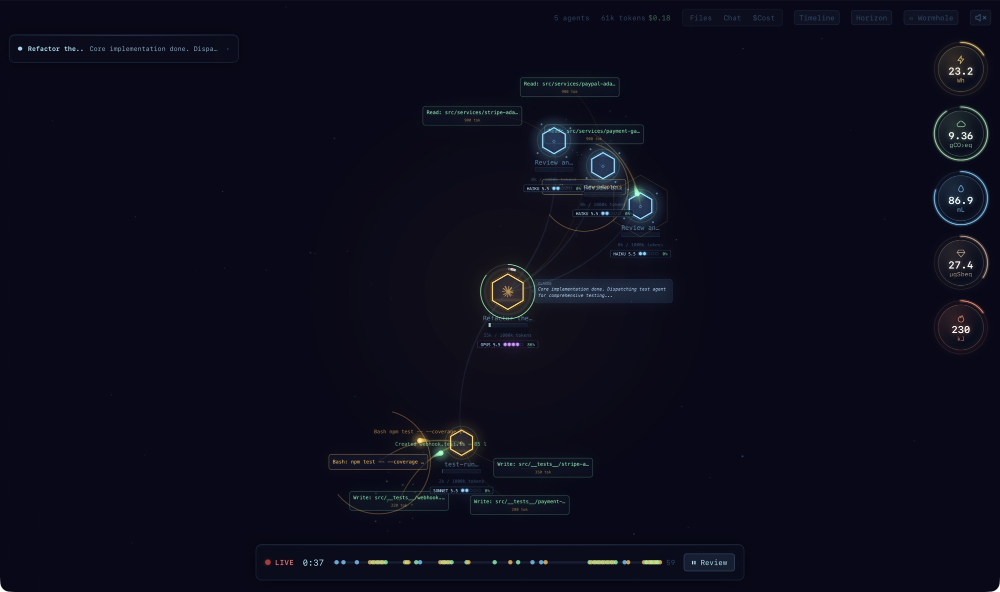
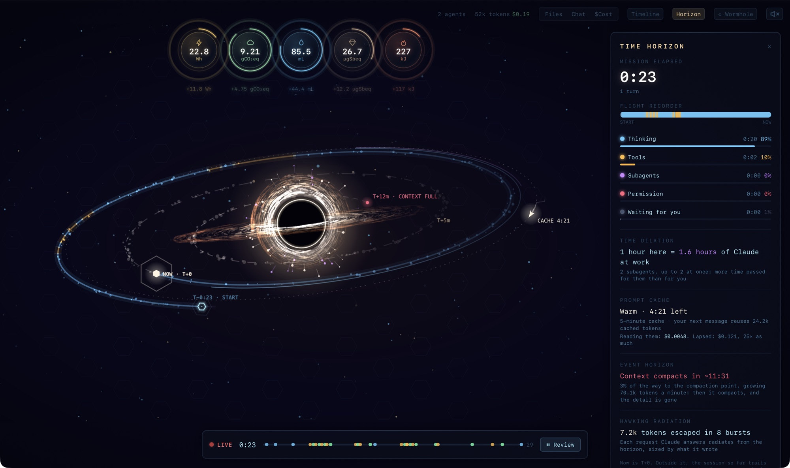

# Agent Flow

See what your Claude Code (and Codex) agents are doing while they do it: who spawned whom, which
tools they reach for, what it costs, and where the context goes.

This is a fork of [patoles/agent-flow](https://github.com/patoles/agent-flow) by Simon Patole. It
follows each Claude Code release closely and adds cost, the prompt cache, compactions, a time
horizon, an environmental footprint and a bridge mod that reports a session from inside Claude
Code.



## What you see

- **The canvas.** Each agent is a node, and its subagents, teammates and workflow agents branch
  off it. Tool calls fly out and return, answers stream in, and a heartbeat pulses with each model
  request. Click anything to inspect it.
- **Cost and the cache.** Each agent's spend, priced from the API's own usage, and how much of
  each prompt the cache served. Its model and effort sit on its card.
- **Context.** How full each agent's context is, and of what: the system prompt and tools as
  Claude Code sent them, your messages, tool results, reasoning and subagent reports.
- **Compactions as wormholes.** When a conversation is compacted, its node opens a wormhole and
  jumps (`⟲ 967k → 13k`). The Wormhole log lists every compaction and forecasts the next. That
  includes an idle compaction, which Claude Code runs before a large, quiet conversation's prompt
  cache lapses.
- **The time horizon.** Where the session's time went, as a disk: thinking, tools, subagents,
  permission dialogs, waiting for you. Subagents are ships on a slingshot, and each compaction
  leaves a mark.
- **The footprint.** Energy and emissions of the requests, after
  [EcoLogits](https://ecologits.ai), at the grid of the region where they ran.
- **Timeline, transcript and files.** Every agent's activity over time, the conversation, and
  which files got the most attention.



Several sessions show side by side as tabs. Claude Code is read from its hooks and transcripts,
and Codex from its rollout files.

| Key | | Key | |
|---|---|---|---|
| `Space` | play / pause | `h` | time horizon |
| `t` | timeline | `w` | wormhole log |
| `c` | transcript | `$` | cost overlay |
| `f` | file attention | `g` | hex grid |
| `F` | zoom to fit | `s` | stats |
| `1`–`4` | playback speed | `m` | mute |

## Run it

The published `npx agent-flow-app` and the Marketplace extension are upstream's builds. For
this fork's features, run it from source:

```bash
git clone https://github.com/jeckyl2010/agent-flow.git
cd agent-flow
pnpm i
pnpm run setup      # adds Agent Flow's hooks to ~/.claude/settings.json (once)
pnpm run dev        # the web app on http://localhost:3000, and the event relay
```

Start Claude Code in another terminal and the session appears. `pnpm run dev:demo` plays a
demo session with a tour of the views, without Claude Code.

For VS Code (or Cursor, Windsurf), build the extension with `pnpm run build:all`, then
`cd extension && npx @vscode/vsce package`, and install the `.vsix`. **Agent Flow: Open Agent Flow**
(`Cmd+Alt+A`) opens it, and it sets up the hooks the first time.

## The bridge mod (recommended)

`plugin/` is a Claude Code mod that reports the session from inside Claude Code, where the hooks
and transcripts only let Agent Flow guess. With it you get:

- tool calls in order, and permission requests only when the dialog actually shows
- the context window, fill and usage as the API measured them, and your rate limits
- answers and thinking as they stream
- compactions as they start and end, and a subagent's own compaction point
- agent teams, workflow runs, resumed subagents, messages between agents, and the advisor's calls
- why a permission asks, and why a turn was refused
- a notification for a refused turn, a failed subagent, or a rate limit 90% used (turn it off
  with the mod's **Notifications** option in `/config`)

```bash
claude --plugin-dir /path/to/agent-flow/plugin
```

`/agent-flow` in Claude Code shows where it sends events. Each feature arrives with the Claude
Code release that reports it, and the mod API is early access: sessions without the mod keep
working from the hooks and transcripts.

## Settings

| Where | Setting | |
|---|---|---|
| VS Code | `agentVisualizer.runtime` | `auto` (both), `claude` or `codex` |
| VS Code | `agentVisualizer.autoOpen` | open when a session starts |
| VS Code | `agentVisualizer.eventLogPath` | replay or tail a JSONL event log |
| Environment | `AGENT_FLOW_RUNTIME` | `claude` or `codex`, for `pnpm run dev` |
| Environment | `CODEX_HOME` | a Codex install outside `~/.codex` |

## Development

Node.js 22+ and pnpm 12. `pnpm run dev:demo` runs the demo, and `pnpm run build:all` builds the
webview and the extension. [docs/ARCHITECTURE.md](docs/ARCHITECTURE.md) covers how it fits
together and how a new Claude Code release is taken in.

```bash
pnpm test                              # web and relay
cd extension && npm test               # extension
claude plugin test plugin              # bridge mod
```

## Privacy

Agent Flow reports nothing anywhere: no telemetry, no analytics, no update checks. It reads your
sessions on your machine and serves them to your browser from `127.0.0.1`. Upstream's opt-in
telemetry has been removed from this fork.

## Credits and license

Agent Flow was created by [Simon Patole](https://github.com/patoles) for
[CraftMyGame](https://craftmygame.com) ([demo video](https://www.youtube.com/watch?v=Ud6eDrFN-TA)).
Apache 2.0, see [LICENSE](LICENSE). "Agent Flow" is a trademark of Simon Patole, see
[TRADEMARK.md](TRADEMARK.md).
