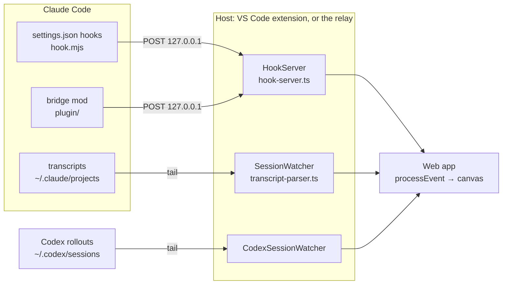

# Architecture

How a Claude Code (or Codex) session becomes the canvas: where the events come from, which source
is believed for what, and how a new Claude Code release finds its way in.

## The flow

Every source is turned into one stream of `AgentEvent`s (`extension/src/protocol.ts`), and the
web app knows nothing about where an event came from.

- **Sources.** Claude Code's hooks run `~/.claude/agent-flow/hook.mjs`, which reads the
  discovery files in `~/.claude/agent-flow/` and posts each payload to the hosts whose workspace
  matches best. The bridge mod posts the same hook-shaped payloads to the same ports. The
  transcripts are tailed from disk, a subagent's from its own `agent-<id>.jsonl`.
- **Hosts.** The same TypeScript runs in three places: the VS Code extension
  (`extension/src/extension.ts`, which hands events to the webview by `postMessage`), the dev
  relay (`scripts/relay.ts`, `pnpm run dev`) and the standalone app (`app/`, the relay plus a
  static server). The relay and the app stream to the browser over SSE on `127.0.0.1`.
- **The web app.** `web/hooks/simulation/process-event.ts` folds each event into mutable state
  (agents, edges, tool calls, timelines, compactions), and `use-agent-simulation.ts` animates it:
  the canvas reads a frame ref at 60 fps, while panels re-render only when the state changes.
  Demo mode plays `web/lib/mock-scenario.ts` through the same path.

## Which source is believed

A session can be seen by all three Claude Code sources at once. Each fact has one owner:

| Fact | With the bridge mod | Without it |
|---|---|---|
| Tool calls, subagents, turns | the mod, in the engine's order | hooks, then the transcript |
| Permission requests | the mod, when the dialog shows | guessed: a tool call pending for a while with the file quiet |
| Usage, cost, context fill, rate limits | the mod, as the API measured them | the transcript's `message.usage` |
| Compactions | the mod, as they start and end | the transcript's `compact_boundary`, after the fact |
| Streaming answers and thinking | the mod | the transcript, entry by entry |
| What the context holds (system prompt, messages, results) | the transcript | the transcript |

`mod-sessions.ts` records which sessions the mod reports. For those, `transcript-parser.ts`,
`subagent-watcher.ts` and `permission-detection.ts` stop inferring, and the transcript only fills
in the context's breakdown. A session without the mod (an older Claude Code, or the mod not
loaded) keeps working on hooks and transcripts alone.

## Where it guesses

Some things neither source states. These are the places to look first when Claude Code changes:

- **Permission requests** without the mod: a timer on pending tool calls
  (`permission-detection.ts`).
- **Idle compaction** (2.1.299+): Claude Code records it as `auto`. An `auto` compaction 50 to 60
  minutes after the main loop last finished is taken as idle, in the mod (`register.ts`) and in
  the transcript parser. The Wormhole log's countdown assumes 54 minutes and 200K tokens, or the
  `CLAUDE_CODE_IDLE_COMPACT_MIN_TOKENS` the mod read. It runs only in the terminal and not where
  settings.json sets `"idleCompaction": false`: the mod reads the session's surface and the
  setting from the engine; without the mod, the transcript's `entrypoint` (`cli`) and the user's
  and project's settings files (`idle-compaction.ts`), not managed settings.
- **Background subagents** without the mod: an Agent call answered `Async agent launched` sent
  its agent to the background, and the `<task-notification>` naming that call ends it
  (`transcript-parser.ts`).
- **The system prompt's size**: estimated from the text of the `api-request-shape` records
  (2.1.300+), a flat 5,000 tokens before them.
- **Token counts of messages and tool results**: estimated from their text (`token-estimator.ts`).
- **Subagent names** without the mod: from the Agent call's description, or the transcript's
  `.meta.json` sidecar.

## A new Claude Code release

The fork follows Claude Code release by release. Each round goes the same way, on a
`contrib/bridge-2-1-<version>` branch:

1. **Read what changed.** The release notes, and the mod API's types, which the
   `plugin-authoring` skill writes for the installed version (`claude-code.d.ts`). Grep them for
   the events the mod hooks.
2. **The mod** (`plugin/hooks/register.ts`): send the new facts as fields on the hook-shaped
   payload, and only when present. The mod needs 2.1.300 or later: drop what only an older engine
   needed rather than keep a fallback for it. Type-check it against the new types, as the mod API
   is early access and changes between releases (2.1.308 dropped the verdict's `decider`). Test it in
   `plugin/tests/bridge.test.ts` (`claude plugin test plugin`).
3. **The host**: add the fields to `HookPayload` in `hook-server.ts` and pass them into the event's
   payload. If the transcript records the same thing, read it in `transcript-parser.ts` too, for
   sessions without the mod. Test in `extension/test/`.
4. **The web**: handle the payload in `web/hooks/simulation/`, add any field to `agent-types.ts`,
   and keep the logic that's worth testing in `web/lib/`, tested from `scripts/*.test.ts`.
5. **Show it**: add a scene to `mock-scenario.ts`, and a stop to its `DEMO_TOUR` if a view should
   point at it. Update the README's list if it's a feature a user would look for.

Check with `pnpm test`, `cd extension && npm test`, `claude plugin test plugin`, both type-checks
and `pnpm run build:all`, as CI does.

## Rules that hold everywhere

- **Nothing leaves the machine.** Hosts listen and post on `127.0.0.1` only. No telemetry,
  analytics or update checks: a change that adds an outbound request is a bug.
- **Older Claude Code keeps working.** A field a new release adds is optional all the way to the
  web app, and the hooks and transcripts remain a full fallback for the mod.
- **One event stream.** A source's quirks are handled in the host. The web app sees only
  `AgentEvent`s and doesn't know which source they came from.
